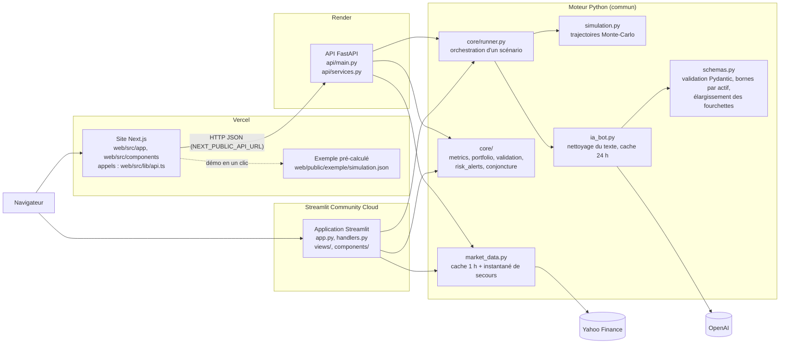

# Architecture de Quant Terminal

Deux interfaces partagent **le même moteur Python** :

- le **site Next.js** (`web/`, hébergé sur Vercel) parle au moteur via l'**API FastAPI** (`api/`, hébergée sur Render) ;
- l'**application Streamlit** (`app.py`, Streamlit Community Cloud) appelle le moteur directement, sans passer par l'API.

## Schéma

## Dossiers et rôles

| Dossier ou fichier | Rôle |
|---|---|
| `web/` | Site Next.js : pages (`src/app/`), composants (`src/components/`), appels à l'API et types (`src/lib/api.ts`), contenus (`src/contenu/`) |
| `web/public/exemple/simulation.json` | Résultat réel calculé à l'avance, affiché par « Essayer avec un exemple » même quand l'API dort |
| `api/` | API FastAPI : routes (`main.py`), formats des demandes (`modeles.py`), logique d'appel au moteur (`services.py`), limites de débit (`limites.py`), protection du portefeuille (`couverture.py`), validation historique (`validation.py`) |
| `app.py` | Routeur de l'application Streamlit (onglets, état de session) |
| `handlers.py` | Flots de lancement Streamlit (état de session, attente, notifications) |
| `views/` | Un fichier par onglet Streamlit |
| `components/` | Composants d'interface Streamlit réutilisables (en-tête, barre latérale, graphiques Plotly…) |
| `core/` | Logique métier pure, sans Streamlit : orchestration (`runner.py`), métriques (`metrics.py`), portefeuille (`portfolio.py`), validations (`validation.py`), alertes (`risk_alerts.py`), etc. |
| `simulation.py` | Moteur de simulation : trajectoires Probabiliste, Historique, Machine Learning et Monte-Carlo |
| `market_data.py` | Cours Yahoo Finance via yfinance, avec cache et instantané de secours |
| `ia_bot.py` | Appels OpenAI (analyse macro, chat, rapport), nettoyage anti-injection, cache |
| `schemas.py` | Validation Pydantic des réponses de l'IA, bornes par actif, élargissement des fourchettes (`elargir_fourchette`) |
| `config.py` | Toutes les constantes (actifs, profils, horizon, 1 000 simulations, modèles d'IA) |
| `pdf_generator.py` | Rapports PDF (ReportLab) |
| `scripts/valider_ia_historique.py` | Confronte l'IA aux 6 crises passées ; résultats dans `data/validation_ia.json`, affichés sur `/validation` |
| `tests/` | Tests pytest du moteur, de `core/` et de l'API |
| `render.yaml` | Déploiement de l'API sur Render |
| `.github/workflows/` | Vérifications (`verifications.yml`), réveil de l'API (`reveil_api.yml`), réveil de Streamlit (`keep_alive.yml`) |

## Chemin d'une simulation (site web)

1. **Formulaire** : l'utilisateur décrit 1 à 3 scénarios et choisit son portefeuille dans `web/src/components/Simulateur.tsx`.
2. **Appel HTTP** : `web/src/lib/api.ts` envoie `POST /api/simulations` à l'adresse `NEXT_PUBLIC_API_URL`.
3. **Entrée dans l'API** : `api/main.py` applique la limite de débit (`api/limites.py`) et valide la demande (`api/modeles.py`), puis appelle `services.executer_simulation` (`api/services.py`).
4. **Contrôles** : les textes des scénarios et le portefeuille sont vérifiés par `core/validation.py`.
5. **Données de marché** : `market_data.py` fournit prix, volatilités et rendements historiques (Yahoo Finance, sinon instantané de secours), ainsi que la conjoncture (taux, inflation).
6. **Un scénario à la fois, en parallèle** : pour chaque scénario, `core/runner.py` (`lancer_simulation_scenario`) appelle l'IA.
7. **IA** : `ia_bot.py` nettoie le texte, consulte son cache, interroge OpenAI, puis `schemas.py` valide la réponse (bornes par actif) et élargit les fourchettes selon le recalage historique.
8. **Simulation** : `simulation.py` applique les chocs aux vrais cours sur l'horizon choisi, avec 1 000 trajectoires Monte-Carlo (`NB_SIMULATIONS_MONTE_CARLO` dans `config.py`).
9. **Métriques** : `api/services.py` calcule poids (`core/portfolio.py`), métriques de risque (`core/metrics.py`) et alertes (`core/risk_alerts.py`), puis renvoie un JSON.
10. **Affichage** : le site affiche les résultats (`web/src/components/Resultats.tsx`), avec exports CSV, PDF (`POST /api/rapports/pdf`) et lien de partage.

Dans l'application Streamlit, les étapes 1 à 3 sont remplacées par `handlers.py`, qui appelle directement `core/runner.py` : le reste du chemin est identique.
